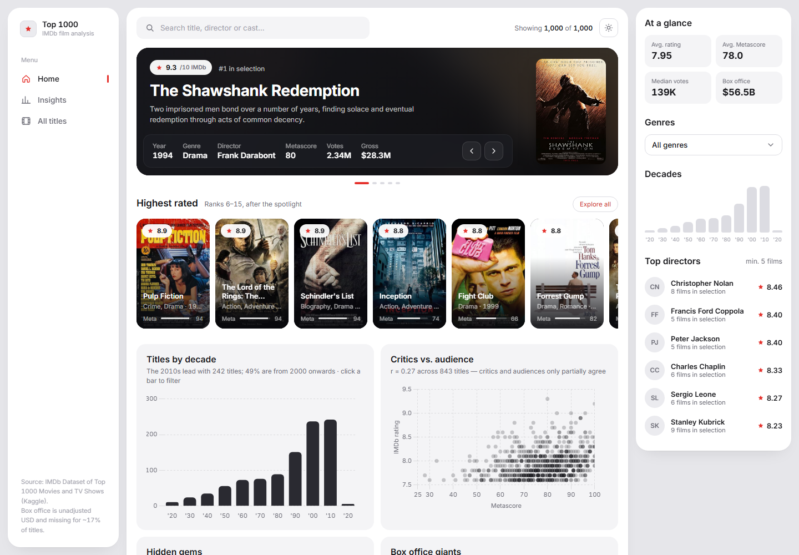
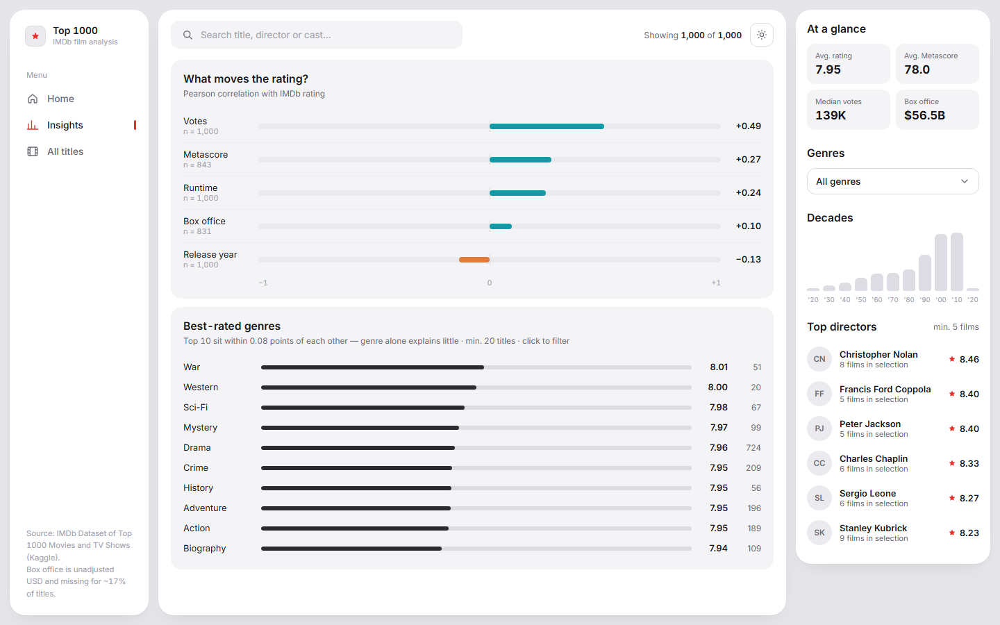
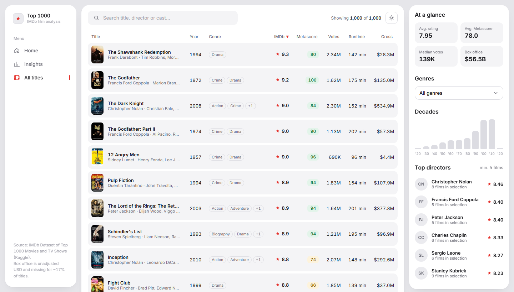
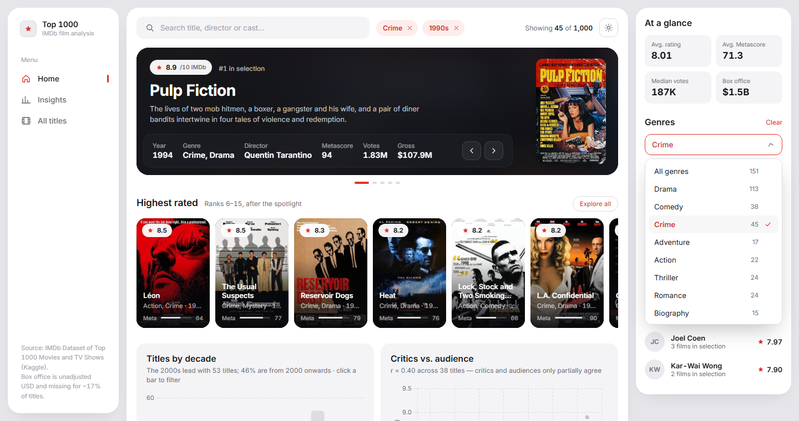
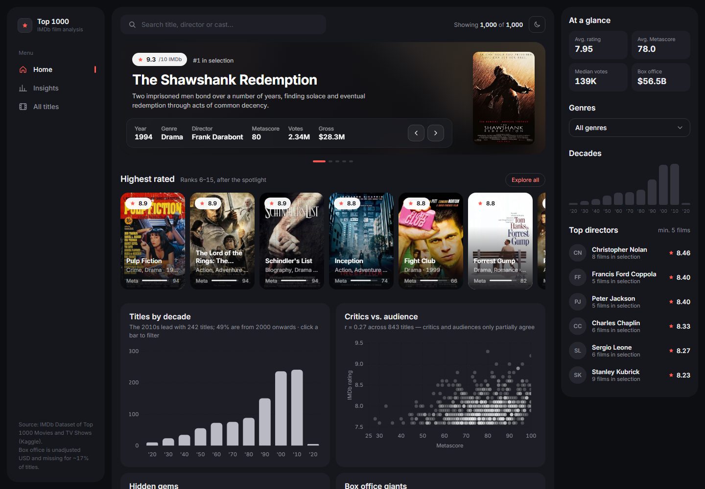
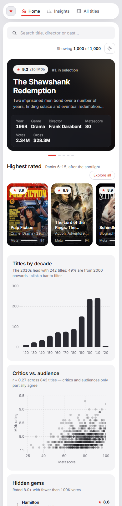

# 🎬 IMDb Top 1000 — Exploratory Data Analysis & Interactive Dashboard



## 📌 Overview

This project performs an **Exploratory Data Analysis (EDA)** of the **1,000 highest-rated titles on IMDb**, focusing on **which factors are associated with perceived quality**, popularity and overall performance.

The goal goes beyond exploring data: it aims to **turn real-world data into clear, defensible insights**, following good practices in data cleaning, analysis and analytical communication — and to deliver them through an **interactive dashboard**.

---

## 🎯 Objectives

* Analyze patterns in **rating (IMDb Rating)**, **popularity (number of votes)** and **critical reception (Metascore)**
* Investigate relationships between **runtime**, **genre**, **release decade** and **rating**
* Assess whether **box-office success** is associated with perceived quality
* Produce a **reproducible, well-documented, portfolio-ready** notebook
* Ship an **interactive dashboard** to explore the results

---

## 🗂️ Dataset

* **Source:** Kaggle — *IMDb Dataset of Top 1000 Movies and TV Shows*
* **Access:** via `kagglehub` (notebook) or the local copy in `data/` (dashboard)
* **Records:** 1,000 titles

**Main columns**

* `series_title`, `released_year`, `genre`
* `imdb_rating`, `meta_score`, `no_of_votes`
* `runtime_min`, `gross`
* `director`, `star1`, `star2`, `star3`, `star4`

⚠️ This is a **highly curated** dataset: it compares *good* titles with *excellent* ones, not good with bad.

---

## 📊 Interactive Dashboard

`dashboard/imdb_dashboard.html` — open it in any browser, no server needed.

A streaming-app inspired dashboard with real posters — light by default, with a dark theme toggle (your choice is remembered).

**Home**
* **Spotlight** — the top 5 titles of the current selection (browse with the arrows), with year, genre, director, Metascore, votes and gross
* **Highest rated** — the next 10 titles as poster cards, each with its Metascore bar
* **Titles by decade** — click a bar to filter the whole dashboard by decade
* **Critics vs. audience** — Metascore × IMDb rating scatter with live correlation
* **Hidden gems** (rated 8.0+ with fewer than 100K votes) and **Box office giants** (highest unadjusted gross)

**Insights**
* **What moves the rating?** — Pearson correlation of votes, Metascore, runtime, box office and release year with the IMDb rating
* **Best-rated genres** — ranked by average rating (minimum sample size applied); click to filter

**All titles**
* Sortable, paginated table with posters; the search bar matches title, director or cast

**Side panel** (always visible) — key numbers, genre chips and decade bars that filter every view, plus the top directors for the current selection.

**Tech:** Vanilla JS · Chart.js · data embedded as JSON — zero build step, zero backend. Posters are loaded from IMDb's image CDN, so an internet connection is needed to see them.

### Screenshots

| Insights | All titles |
|:---:|:---:|
|  |  |
| **Filtering — Crime · 1990s** | **Dark theme** |
|  |  |

<p align="center">
  <br>
  <sub>Responsive layout on a phone</sub>
</p>

To regenerate it after changing the data:

```
python scripts/build_dashboard.py
```

---

## 🛠️ Tech Stack

* Python
* Pandas
* Matplotlib
* Jupyter Notebook
* kagglehub
* Chart.js (dashboard)
* Virtual environment (`venv`)

---

## 🧠 Methodology

1. **Data audit**
   * Data types, missing values and duplicates
2. **Cleaning and standardization**
   * Safe type conversions
   * Explicit handling of nulls (box office is never imputed)
   * Fix for a known data-entry error (*Apollo 13* had its certificate in the year column)
3. **Feature engineering**
   * Release decade
   * Revenue in millions of USD
   * Genre explode (a title can belong to several genres)
4. **Exploratory analysis**
   * Distributions
   * Rankings
   * Correlations
   * Group analyses (genre, decade, directors and cast)
5. **Insight synthesis**
   * Clear, defensible conclusions

---

## 📈 Key Insights

* The **average rating is 7.95**, ranging from **7.6 to 9.3**
* **Popularity is the strongest signal:** votes show a **moderate correlation** with rating (r ≈ 0.49)
* **Critics and audiences only partially agree:** Metascore vs. IMDb rating r ≈ 0.27
* The relationship between **runtime and rating is weak** (r ≈ 0.24)
* **Box-office success does not guarantee a high rating** (r ≈ 0.10)
* Genres such as **War, Western, Sci-Fi and Mystery** have the highest averages — but the top 10 genres sit within **less than 0.1 point** of each other, so genre alone explains very little
* **Recent titles enter the Top 1000 more often** (about half are from 2000 onwards), with no evidence that they are rated higher (release year vs. rating r ≈ −0.13)

**Main takeaway:**
Perceived quality on IMDb results from **several combined factors**, not from any single element.

---

## 📁 Project Structure

```
imdb-analysis/
│
├── dashboard/
│   └── imdb_dashboard.html     — Self-contained interactive dashboard
│
├── data/
│   └── imdb_top_1000.csv
│
├── images/
│   ├── dashboard.png           — Dashboard screenshot (Home)
│   ├── insights.png, titles.png, filters.png, dark.png, mobile.png — Gallery
│   └── graficos.png            — Runtime vs. rating chart from the notebook
│
├── notebooks/
│   └── analise_imdb.ipynb      — Full EDA (in Portuguese)
│
├── scripts/
│   └── build_dashboard.py      — Regenerates the dashboard from the CSV
│
├── README.md
└── requirements.txt
```

---

## ▶️ Running Locally

### Create and activate a virtual environment

Linux / macOS:

```
python -m venv venv
source venv/bin/activate
```

Windows (PowerShell):

```
python -m venv venv
.\venv\Scripts\Activate.ps1
```

### Install dependencies

```
pip install --upgrade pip
pip install -r requirements.txt
```

### Run the notebook

```
jupyter notebook
```

Select the virtual environment's kernel before running the cells.

---

## ⚠️ Limitations

* Restricted to the **Top 1000 titles** (selection bias)
* Incomplete box-office data (~17% missing)
* No adjustment for inflation or historical context

---

## 🔜 Next Steps

* ~~Build an interactive dashboard~~ ✅
* Explore simple predictive models
* Integrate external data (APIs)

---

## 👤 Author

**Lorenna Pais**
Data Analyst
